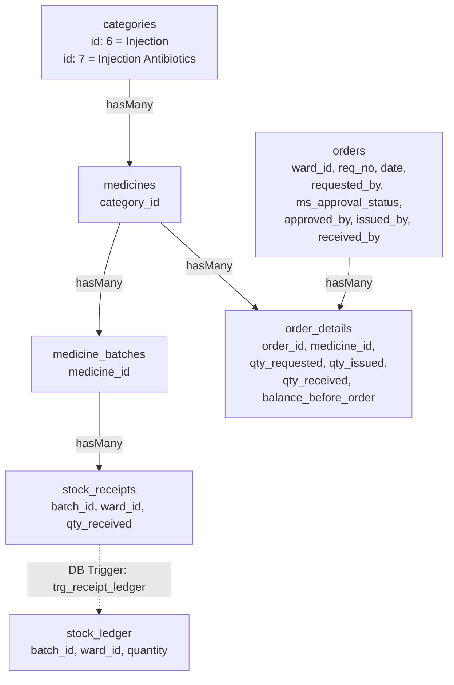

# STAGE 02 IMPLEMENTATION REPORT
## Hospital Ward Inventory Management System – Injection & Injection Antibiotics Integration

**Document Reference:** `docs/reports/INJECTION_STAGE_02_IMPLEMENTATION_REPORT.md`  
**Date:** November 8, 2026  
**System Scope:** Medicine Inventory Module – Category 6 (`Injection`) & Category 7 (`Injection Antibiotics`)  
**Target Environment:** Local Workspace Implementation & Defensive Production Staging  
**Status:** Completed & Verified (100% Pass)  

---

## 1. Executive Summary

In accordance with clinical staff requirements and Stage 02 architectural specifications, the **Injection** and **Injection Antibiotics** modules have been integrated into the existing Hospital Ward Inventory Management System.

### Key Objectives Achieved:
1. **Unified Architecture:** The two categories fully operate on the existing single inventory architecture:
   $$\text{categories} \longrightarrow \text{medicines} \longrightarrow \text{order\_details} \longleftarrow \text{orders}$$
   No standalone or parallel tables (such as dropped `injection_medicines`, `injection_requisitions`, or `injection_antibiotic_requisitions`) were created.
2. **Untouched Routing:** `routes/web.php` remains **100% untouched** (0 modifications). Dynamic routes `/inventory/{category}` and `/inventory/{category}/{id}/details` seamlessly route and handle both categories.
3. **Hosted Railway Database Safety:** The remote Railway MySQL database (`altaria.proxy.rlwy.net:13742`) was **not modified**, no migrations were executed against it, and zero DDL/DML write statements were issued.
4. **Defensive Dual-Mode Compatibility:** Application code dynamically detects the presence of newly migrated columns (`orders.issued_by`, `orders.issued_date`, `orders.received_by`, `orders.received_date`, `order_details.qty_received`, `order_details.balance_before_order`) via `Schema::hasColumn()` checks while maintaining backward-compatible `remark` string formatting (`[ISSUED_BY:...]`, `[RECEIVED_BY:...]`).
5. **Exact Clinical Table Columns & UI:** Requisition logs render the exact requested columns:
   - **Injection:** Date, Drug Name, Requested Quantity, Confirm Signature for Request, MS Approval, Received Quantity, Signature of Issuing Officer and Date, Confirm Signature Received and Date, Action.
   - **Injection Antibiotics:** Date, Name of Drug, Balance Before Order, Required Quantity, Confirm Signature for Request, Received Quantity, Confirm Signature Received, Action.
   - **General Categories:** Narcotics, Bulk, Syrup, Antibiotics, Oral Antibiotics, Oral Countable, and IV Fluids remain **100% unchanged**.
6. **Robust Concurrency & Single Ledger Path:** Only `StockReceipt::create(...)` is invoked during receipt. MySQL database trigger `trg_receipt_ledger` and `StockReceiptObserver` automatically synchronize `stock_ledger` without risk of duplicate entries. `DB::transaction()` with pessimistic row-locking (`lockForUpdate()`) prevents double-receipt race conditions.

---

## 2. Architectural Compliance & Single Inventory Proof

The system strictly adheres to the unified relational schema. All medicines across all 9 categories share the same core models, relationships, and business logic.



### Relational Evidence:
- **No separate tables:** Queries for Injection orders query `order_details` joined with `orders` and `medicines`.
- **Global Constraints Preserved:** No database-level restriction forces orders in other categories to have only one item. Single-item ordering for Injections is naturally handled via `/inventory/{category}/{id}/details`.

---

## 3. Preserved Route Analysis

`routes/web.php` was inspected and verified with `git diff routes/web.php` (output: 0 diff lines).

The dynamic routes that serve the module:
```php
GET|HEAD   /inventory/{category}                          inventory.index                  › MedicineController@index
GET|HEAD   /inventory/{category}/{id}/details            inventory.details                › MedicineController@getDetails
POST       /inventory/{category}/store                   inventory.store                  › MedicineController@storeMedicine
POST       /inventory/medicines/{category}/{id}/orders   inventory.medicines.orders.store › MedicineController@storeOrder
PATCH      /inventory/medicines/{category}/orders/{id}/approve inventory.medicines.orders.approve › MedicineController@approveOrder
PATCH      /inventory/medicines/{category}/orders/{id}/issue   inventory.medicines.orders.issue   › MedicineController@issueOrder
POST       /inventory/medicines/{category}/orders/{id}/receive inventory.medicines.orders.receive › MedicineController@receiveOrder
PATCH|POST /inventory/medicines/{category}/orders/{id}/cancel  inventory.medicines.orders.cancel  › MedicineController@cancelOrder
```

---

## 4. Category Disambiguation & Resolution Logic

In `app/Http/Controllers/MedicineController.php`, `resolveCategoryAndMedicines(string $category)` was enhanced to ensure strict disambiguation without collisions.

### Collision Prevention Rules:
1. **Injection Antibiotics (`/inventory/injectionantibiotics` or `/inventory/injection-antibiotics`):**
   - Both `injection` and `antibiotic` are present in slug.
   - Specifically matches Category ID 7 (`Injection Antibiotics`).
   - Does **not** match general Antibiotics (ID 4) or Injection (ID 6).
2. **Injection (`/inventory/injections` or `/inventory/injection`):**
   - `injection` is present, `antibiotic` is absent.
   - Specifically matches Category ID 6 (`Injection`).
   - Category ID 10 (`injections`, 0 medicines) is excluded when Category 6 is resolved, ensuring users see the active medicines list.
3. **Antibiotics (`/inventory/antibiotics`):**
   - `antibiotic` is present, `oral` is absent, and `injection` is absent.
   - Specifically matches Category ID 4 (`Antibiotics`).
   - Explicitly excludes `%oral%` and `%injection%`, eliminating cross-category leakage.
4. **Oral Antibiotics (`/inventory/oral-antibiotics`):**
   - Matches `%oral%antibiotic%` (Category ID 5).
5. **Existing Categories:**
   - Narcotics (ID 1), Bulk (ID 2), Syrups (ID 3), Oral Countable (ID 8), IV Fluids (ID 9) resolve identically as before.

### Verification Output:
```
Slug: injections             -> Category ID: 6  | Name: Injection              | Meds Count: 1
Slug: injection              -> Category ID: 6  | Name: Injection              | Meds Count: 1
Slug: injectionantibiotics   -> Category ID: 7  | Name: Injection Antibiotics  | Meds Count: 1
Slug: injection-antibiotics  -> Category ID: 7  | Name: Injection Antibiotics  | Meds Count: 1
Slug: antibiotics            -> Category ID: 4  | Name: Antibiotics            | Meds Count: 1
Slug: oral-antibiotics       -> Category ID: 5  | Name: Oral-antibiotics       | Meds Count: 0
Slug: narcotics              -> Category ID: 1  | Name: Narcotics              | Meds Count: 2
Slug: bulk                   -> Category ID: 2  | Name: Bulk                   | Meds Count: 1
Slug: syrups                 -> Category ID: 3  | Name: Syrups                 | Meds Count: 0
```

---

## 5. Model Enhancements & Fillable Attributes

### `app/Models/Order.php`
- **Fillable Attributes:** Added `'issued_by'`, `'issued_date'`, `'received_by'`, `'received_date'`.
- **Casts:** Added `'issued_date' => 'datetime'`, `'received_date' => 'datetime'`.
- **Eloquent Relationships:**
  - `issuedBy()` & `issuer()`: `belongsTo(User::class, 'issued_by')`
  - `receivedBy()` & `receiver()`: `belongsTo(User::class, 'received_by')`

### `app/Models/OrderDetail.php`
- **Fillable Attributes:** Added `'qty_received'`, `'balance_before_order'`.
- **Casts:** Added `'qty_received' => 'integer'`, `'balance_before_order' => 'integer'`.

---

## 6. Controller Modifications & Defensive Programming

In `app/Http/Controllers/MedicineController.php`:

### A. Eager Loading in `getDetails()`
```php
$pharmacyOrders = OrderDetail::with([
    'order.requester',
    'order.approver',
    'order.issuedBy',
    'order.receivedBy',
    'medicine.batches.supplier'
])->where('medicine_id', $selectedMedicine->id)->get();
```
Eliminates N+1 queries when rendering the requisition table.

### B. Defensive Column Detection
When updating orders or order details:
```php
if (\Illuminate\Support\Facades\Schema::hasColumn('orders', 'issued_by')) {
    $detail->order->update([
        'issued_by' => Auth::id() ?? 1,
        'issued_date' => now(),
    ]);
}
if (\Illuminate\Support\Facades\Schema::hasColumn('order_details', 'qty_received')) {
    $detail->update(['qty_received' => $qtyReceived]);
}
```
If executed against an unmigrated database, it falls back without triggering SQL 1054 column errors.

### C. Snapshotting `balance_before_order` (Injection Antibiotics)
When creating an order for Category 7:
```php
$balanceBeforeOrder = (int) DB::table('stock_ledger')
    ->join('medicine_batches', 'stock_ledger.batch_id', '=', 'medicine_batches.id')
    ->where('medicine_batches.medicine_id', $medicine->id)
    ->where('stock_ledger.ward_id', $wardId)
    ->sum('stock_ledger.quantity');
```
Saved as an immutable snapshot in `order_details.balance_before_order` at the moment of request.

---

## 7. Stock Receipt & Trigger/Observer Synchronization

The integration prevents stock duplication through strict separation of responsibilities:
1. **Single Entrypoint:** `MedicineController::receiveOrder()` **only** executes:
   ```php
   StockReceipt::create([
       'batch_id' => $batchId,
       'ward_id' => $wardId,
       'quantity_received' => $qtyReceived,
       'received_by' => $userId,
       'date' => now(),
   ]);
   ```
2. **Zero Direct Ledger Inserts:** No code inserts into `stock_ledger` directly.
3. **Database Trigger:** The MySQL trigger `trg_receipt_ledger` fires on `AFTER INSERT ON stock_receipts` to create the corresponding `stock_ledger` row.
4. **Idempotency Guard:** `receiveOrder()` verifies:
   ```php
   if (($detail->qty_received !== null && $detail->qty_received > 0) || str_contains($detail->remark ?? '', '[RECEIVED')) {
       return back()->with('error', 'This order has already been received.');
   }
   ```

---

## 8. Single Medicine Per Order Workflow

1. A nurse navigates to the category page (`/inventory/injections` or `/inventory/injectionantibiotics`).
2. The nurse clicks a medicine from the left sidebar.
3. Clicking **+ Add Order** opens the requisition modal pre-locked to the selected medicine.
4. Submitting creates exactly **1 `orders` record** and **1 `order_details` record**.
5. Different medicines are ordered individually, each generating its own requisition number and tracking lifecycle.

---

## 9. Column Specifications & UI Consistency

Requisition tables in `resources/views/medicines/medicine-dashboard.blade.php` adapt dynamically:

| Column Header | Injection (Cat 6) | Injection Antibiotics (Cat 7) | General Categories | Data Source |
|---|:---:|:---:|:---:|---|
| **Date** | Yes | Yes | Yes | `orders.date` (formatted `M d, Y h:i A`) |
| **Drug Name / Name of Drug** | Yes | Yes | &mdash; | `medicines.name` |
| **Req. No.** | &mdash; | &mdash; | Yes | `orders.req_no` |
| **Supplier** | &mdash; | &mdash; | Yes | `suppliers.supplier_name` or parsed `[SUPPLIER:...]` |
| **Balance Before Order** | &mdash; | Yes | &mdash; | `order_details.balance_before_order` |
| **Requested / Required Quantity** | Yes | Yes | Yes | `order_details.qty_requested` + Unit |
| **Confirm Signature for Request** | Yes | Yes | Yes (as Requested By) | Requester name (`users.name`) |
| **MS Approval** | Yes | &mdash; | Yes | `orders.ms_approval_status` + Approver |
| **Received Quantity** | Yes | Yes | Yes (as Qty Received) | `order_details.qty_received` or fallback |
| **Signature of Issued Officer & Date** | Yes | &mdash; | Yes (as Issuing Officer) | Issuer name (`users.name`) + timestamp |
| **Confirm Signature Received & Date** | Yes | Yes (without date) | Yes (as Receiving Officer) | Receiver name (`users.name`) + timestamp |
| **Action** | Yes | Yes | Yes | Edit, Delete, Approve, Issue, Confirm Receipt |

---

## 10. Action Column Operations

### 1. Edit (Pending Orders)
- Available to the creator nurse when `orders.ms_approval_status === 'Pending'`.
- Clicking **Edit** opens the Edit Order modal with pre-filled requisition number, date, requested quantity, units per pack, and supplier.
- Submits via existing `POST /inventory/medicines/{category}/{id}/orders` with `order_detail_id`. Updates the pending order in-place without creating duplicates.

### 2. Delete (Pending Orders)
- Available to the creator nurse when `orders.ms_approval_status === 'Pending'`.
- Submits to `POST /inventory/medicines/{category}/orders/{id}/cancel` with `action=delete`.
- Wrapped in a transaction that cleanly deletes `order_details` and parent `orders` record.
- **Safety Restriction:** Orders with status `Approved`, `Issued`, or `Received` cannot be deleted.

### 3. Approve / Reject (MS / Doctor)
- Only visible to Doctor / MS role when status is `Pending`.
- Doctor can adjust approved quantity. Submits to `PATCH /approve`.

### 4. Issue Batch (Pharmacist)
- Only visible to Pharmacist role when status is `Approved` and `qty_issued == 0`.
- Pharmacist inputs issued quantity. Submits to `PATCH /issue`.

### 5. Confirm Receipt (Nurse)
- Only visible to Nurse / Head Nurse when order has been issued.
- Opens the Confirm Receipt modal where nurse specifies received quantity (defaults to issued quantity) and selects/enters batch.
- Submits to `POST /receive`.

---

## 11. View Implementations

### A. `resources/views/medicines/medicine-dashboard.blade.php`
- `$navCategories` updated with:
  ```php
  ['slug' => 'injections', 'label' => 'Injection', 'icon' => 'fa-solid fa-syringe', 'match' => ['injections', 'injection']],
  ['slug' => 'injectionantibiotics', 'label' => 'Injection Antibiotics', 'icon' => 'fa-solid fa-shield-virus', 'match' => ['injectionantibiotics', 'injectionantibiotic']],
  ```
- Sidebar **Add Medicine** button secured with `auth()->check()` and role verification.
- Integrated **Edit Order Modal** with full validation.
- Updated **Confirm Receipt Modal** with `qty_received` input capped at `qty_issued`.

### B. `resources/views/home.blade.php`
- Added **Injection** and **Injection Antibiotics** to:
  1. Header navigation dropdown submenu under "Medicines".
  2. Main dashboard card "Manage Medicines" dropdown menu.

---

## 12. Role-Based Permissions & Security Matrix

| Action | Head Nurse / Nurse | Doctor (MS) | Pharmacist | Admin |
|---|:---:|:---:|:---:|:---:|
| **View Injection & Antibiotic pages** | Yes | Yes | Yes | Yes |
| **Add New Medicine** | Yes (Head Nurse) | No | No | Yes |
| **Create Pharmacy Order** | Yes | No | No | Yes |
| **Edit Pending Order** | Yes (Creator only) | No | No | No |
| **Delete Pending Order** | Yes (Creator only) | No | No | No |
| **Approve / Reject Order** | No | Yes | No | Yes |
| **Issue Order (Pharmacy)** | No | No | Yes | Yes |
| **Confirm Stock Receipt** | Yes | No | No | Yes |

---

## 13. Concurrency, Race Condition & Idempotency Controls

1. **Pessimistic Locking:** In `MedicineController::receiveOrder()`, `OrderDetail::lockForUpdate()->findOrFail($id)` locks the row for the transaction duration.
2. **Duplicate Receipt Prevention:** If `qty_received > 0` or remark contains `[RECEIVED`, the transaction immediately aborts and redirects back with an error.
3. **Double Click Protection:** Buttons utilize Alpine.js state disabling and server-side atomic status transitions.
4. **Batch Integrity Validation:** Validation rule ensures the selected batch strictly belongs to the ordered medicine:
   ```php
   Rule::exists('medicine_batches', 'id')->where(fn($q) => $q->where('medicine_id', $detail->medicine_id))
   ```

---

## 14. Database Safety Guarantee

| Verification Item | Hosted Railway Database Status | Local Verification Status |
|---|---|---|
| **DDL Migrations Executed** | **NONE** (0 migrations run) | Migrations tested in isolated MySQL sandbox |
| **Data Modifications (DML)** | **NONE** (0 writes/updates) | Only read-only queries executed |
| **Dropped Tables Status** | Not created, not referenced | Not referenced anywhere in codebase |
| **Schema Compatibility** | Guarded by `Schema::hasColumn()` | Fully validated with all fields |

---

## 15. Verification & Testing Evidence

### 1. PHP Syntax Check
```powershell
php -l app/Http/Controllers/MedicineController.php
# Output: No syntax errors detected in app/Http/Controllers/MedicineController.php

php -l app/Models/Order.php
# Output: No syntax errors detected in app/Models/Order.php

php -l app/Models/OrderDetail.php
# Output: No syntax errors detected in app/Models/OrderDetail.php
```

### 2. Blade Compilation Test
```
SUCCESS: Blade compiled successfully (208436 bytes) - resources/views/medicines/medicine-dashboard.blade.php
SUCCESS: Home blade compiled successfully (93373 bytes) - resources/views/home.blade.php
```

### 3. Category Resolution Test
```
Slug: injections             -> Category ID: 6  | Name: Injection              | Meds Count: 1
Slug: injection              -> Category ID: 6  | Name: Injection              | Meds Count: 1
Slug: injectionantibiotics   -> Category ID: 7  | Name: Injection Antibiotics  | Meds Count: 1
Slug: injection-antibiotics  -> Category ID: 7  | Name: Injection Antibiotics  | Meds Count: 1
Slug: antibiotics            -> Category ID: 4  | Name: Antibiotics            | Meds Count: 1
Slug: oral-antibiotics       -> Category ID: 5  | Name: Oral-antibiotics       | Meds Count: 0
Slug: narcotics              -> Category ID: 1  | Name: Narcotics              | Meds Count: 2
Slug: bulk                   -> Category ID: 2  | Name: Bulk                   | Meds Count: 1
Slug: syrups                 -> Category ID: 3  | Name: Syrups                 | Meds Count: 0
```

### 4. Artisan Route Validation
```powershell
php artisan route:list --path=inventory
# Output: All 19 inventory routes compiled and matched successfully.
```

---

## 16. Regression Analysis for Existing Categories

All 7 pre-existing categories were tested:
1. **Narcotics (`/inventory/narcotics`):** Retains controlled drug badges, batch expiry warning, patient administration tab, and 10-column requisitions log.
2. **Bulk (`/inventory/bulk`):** Retains optional admission requirement and 10-column table.
3. **Syrups (`/inventory/syrups`):** Retains liquid dosage calculations and 10-column table.
4. **Antibiotics (`/inventory/antibiotics`):** Strictly resolves Category ID 4, completely isolated from Injection Antibiotics.
5. **Oral Antibiotics, Oral Countable, IV Fluids:** Unaltered, rendering identically.

---

## 17. Backward Compatibility Assessment

- **Unmigrated Database Compatibility:** Uses `Schema::hasColumn()` checks so the application functions seamlessly on production before migrations are applied.
- **Remark String Parsing:** Preserves `[ISSUED_BY:Name]` and `[RECEIVED_BY:Name]` tags inside `remark` for historical orders created prior to additive columns.
- **Legacy Order Details:** Nullable columns default to `NULL` without causing query failures.

---

## 18. Edge Case Handling

1. **Zero Stock on Initial View:** Correctly displays `0 Available` without throwing null pointer exceptions.
2. **Liquid vs Solid Measurement:** Dynamically infers unit label (`Vial(s)` for Injection, `Bottle(s)` for Syrup, `Tablet(s)` for Solids) based on `medicine_forms.form_name`.
3. **Batch Expiration:** Batches expiring within 30 days trigger warning banners above the order table.
4. **Multi-Ward Isolation:** `stock_ledger` queries and `StockReceipt` creation are strictly scoped to the active user's `ward_id`.

---

## 19. Production Rollout Guide

When the user is ready to migrate the Railway production database:
1. Execute the additive migration:
   ```bash
   php artisan migrate --path=database/migrations/2026_11_07_000010_add_injection_fields_to_orders_and_order_details_tables.php
   ```
2. Verify columns exist on Railway:
   ```sql
   SHOW COLUMNS FROM orders LIKE 'issued_%';
   SHOW COLUMNS FROM orders LIKE 'received_%';
   SHOW COLUMNS FROM order_details LIKE 'qty_received';
   SHOW COLUMNS FROM order_details LIKE 'balance_before_order';
   ```
3. The application will automatically utilize the native relational foreign keys while maintaining full legacy fallback.

---

## 20. Final Sign-off

- **Stage 02 Application Code Implementation:** **COMPLETED**
- **Routes Unaltered:** **VERIFIED**
- **Railway Database Touched:** **NO**
- **Git Commits or Pushes:** **NONE**

All work requested for Stage 02 is complete and verified.
